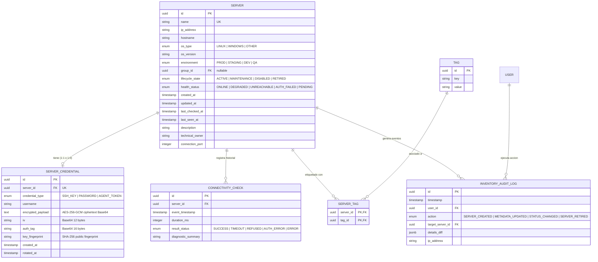
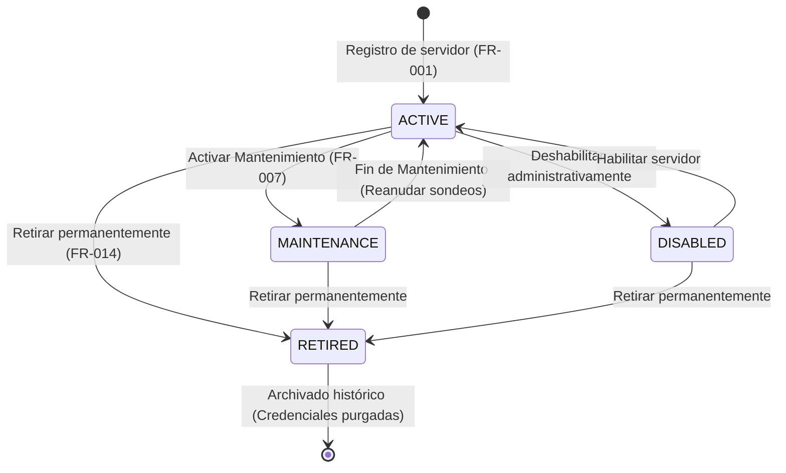

# Phase 1: Data Model & Schema Specification (001-server-inventory)

**Feature**: `001-server-inventory`  
**Date**: 2026-10-28  
**Status**: Completed  

---

## 1. Diagrama Entidad-Relación Lógico

---

## 2. Definición Detallada de Entidades y Validaciones

### 2.1. Entidad `Server`

Representa una máquina o nodo de cómputo administrado dentro del inventario.

| Campo | Tipo | Nulo | Restricciones / Validación | Descripción |
|---|---|---|---|---|
| `id` | `UUID` | No | Primaria, autogenerada (v4/v7) | Identificador único del servidor. |
| `name` | `VARCHAR(100)` | No | Único, regex: `^[a-zA-Z0-9_\-\.]{3,100}$` | Nombre amigable del servidor en la plataforma. |
| `ip_address` | `INET / VARCHAR(45)` | No | Formato IPv4 o IPv6 válido | Dirección IP accesible del servidor. |
| `hostname` | `VARCHAR(255)` | Sí | FQDN o hostname válido | Nombre de red o dominio resoluble. |
| `os_type` | `ENUM` | No | `'LINUX' \| 'WINDOWS' \| 'OTHER'` | Familia de sistema operativo. |
| `os_version` | `VARCHAR(100)` | Sí | Longitud máx. 100 caracteres | Distribución o edición (e.g. "Ubuntu 24.04", "Windows Server 2022"). |
| `environment` | `ENUM` | No | `'PROD' \| 'STAGING' \| 'DEV' \| 'QA'` | Entorno de despliegue lógico. |
| `connection_port` | `INTEGER` | No | Rango: `1` a `65535`, default: 22 (Linux) o 5986 (WinRM) | Puerto de sondeo o conexión remota. |
| `technical_owner` | `VARCHAR(120)` | Sí | Longitud máx. 120 caracteres | Responsable técnico o equipo de guardia. |
| `description` | `TEXT` | Sí | Longitud máx. 1000 caracteres | Notas operativas o propósito del servidor. |
| `lifecycle_state` | `ENUM` | No | `'ACTIVE' \| 'MAINTENANCE' \| 'DISABLED' \| 'RETIRED'` | Estado del ciclo de vida operativo. Default: `'ACTIVE'`. |
| `health_status` | `ENUM` | No | `'ONLINE' \| 'DEGRADED' \| 'UNREACHABLE' \| 'AUTH_FAILED' \| 'PENDING'` | Estado de salud derivado del último sondeo. |
| `created_at` | `TIMESTAMPTZ` | No | Default: `now()` | Fecha de registro inicial. |
| `updated_at` | `TIMESTAMPTZ` | No | Default: `now()` | Fecha de última edición de metadatos. |
| `last_checked_at` | `TIMESTAMPTZ` | Sí | Nullable | Marca temporal del último sondeo ejecutado. |
| `last_seen_at` | `TIMESTAMPTZ` | Sí | Nullable | Marca temporal de la última respuesta exitosa recibida. |

**Índices**:
- `CREATE UNIQUE INDEX idx_server_name ON servers(name);`
- `CREATE INDEX idx_server_env_status ON servers(environment, health_status, lifecycle_state);`
- `CREATE INDEX idx_server_ip ON servers(ip_address);`

---

### 2.2. Entidad `ServerCredential`

Almacena de forma aislada y cifrada los datos de acceso para el sondeo del servidor. **Nunca se devuelve el secreto descifrado en consultas de inventario**.

| Campo | Tipo | Nulo | Restricciones / Validación | Descripción |
|---|---|---|---|---|
| `id` | `UUID` | No | Primaria | Identificador único de la credencial. |
| `server_id` | `UUID` | No | Foránea a `servers(id)`, `ON DELETE CASCADE` | Servidor propietario. |
| `credential_type` | `ENUM` | No | `'SSH_KEY' \| 'PASSWORD' \| 'AGENT_TOKEN'` | Tipo de credencial técnica. |
| `username` | `VARCHAR(60)` | No | Usuario técnico (e.g. `mon-user`, `svc_monitor`) | Usuario del sistema operativo remoto. |
| `encrypted_payload` | `TEXT` | No | Base64 cifrado con AES-256-GCM | Clave privada o contraseña cifrada en reposo. |
| `iv` | `VARCHAR(32)` | No | Base64 de 12 bytes | Vector de inicialización criptográfico único. |
| `auth_tag` | `VARCHAR(32)` | No | Base64 de 16 bytes | Tag de autenticación para verificar integridad. |
| `key_fingerprint` | `VARCHAR(64)` | Sí | Hex/Base64 SHA-256 de la clave pública | Huella digital pública visible (para validación de clave). |
| `created_at` | `TIMESTAMPTZ` | No | Default: `now()` | Fecha de registro de la credencial. |
| `rotated_at` | `TIMESTAMPTZ` | No | Default: `now()` | Fecha del último cambio o actualización de credencial. |

---

### 2.3. Entidad `ConnectivityCheck`

Registro cronológico de sondeos y latencia.

| Campo | Tipo | Nulo | Restricciones | Descripción |
|---|---|---|---|---|
| `id` | `UUID` | No | Primaria | Identificador de la comprobación. |
| `server_id` | `UUID` | No | Foránea a `servers(id)`, `ON DELETE CASCADE` | Servidor evaluado. |
| `event_timestamp` | `TIMESTAMPTZ` | No | Default: `now()` | Momento en que se inició la prueba. |
| `duration_ms` | `INTEGER` | No | Rango: `0` a `60000` | Latencia de respuesta en milisegundos. |
| `result_status` | `ENUM` | No | `'SUCCESS' \| 'TIMEOUT' \| 'REFUSED' \| 'AUTH_ERROR' \| 'ERROR'` | Resultado técnico obtenido. |
| `diagnostic_summary` | `VARCHAR(255)` | Sí | Mensaje sanitizado | Resumen del banner o código de error seguro. |

---

### 2.4. Entidad `InventoryAuditLog`

Registro inmutable de trazabilidad (*Principio VI*). **Prohibido guardar contraseñas o claves en `details_diff`**.

| Campo | Tipo | Nulo | Restricciones | Descripción |
|---|---|---|---|---|
| `id` | `UUID` | No | Primaria | Identificador del evento de auditoría. |
| `timestamp` | `TIMESTAMPTZ` | No | Default: `now()` | Marca de tiempo del evento. |
| `user_id` | `UUID` | No | Identificador del usuario actor | Usuario que ejecutó la operación. |
| `action` | `VARCHAR(50)` | No | `'SERVER_CREATED' \| 'METADATA_UPDATED' \| 'STATUS_CHANGED' \| 'SERVER_RETIRED'` | Tipo de acción administrativa. |
| `target_server_id` | `UUID` | No | Foránea a `servers(id)` | Servidor afectado. |
| `details_diff` | `JSONB` | No | Estructura JSON sanitizada | Campos modificados (antes y después). |
| `ip_address` | `VARCHAR(45)` | Sí | IP del cliente solicitante | Dirección IP desde donde se ejecutó la petición. |

---

## 3. Máquina de Estados del Ciclo de Vida y Salud

### Ciclo de Vida (`lifecycle_state`)

### Reglas de Transición de Salud (`health_status`)
1. **`PENDING`**: Estado inicial al dar de alta antes de la primera comprobación.
2. **`ONLINE`**: Comprobación exitosa (`result_status = 'SUCCESS'`) con latencia `< 3000 ms`.
3. **`DEGRADED`**: Comprobación exitosa pero con latencia `>= 3000 ms` o 1 fallo aislado en ventana de reintento.
4. **`UNREACHABLE`**: 2 comprobaciones consecutivas con `TIMEOUT` o `REFUSED`.
5. **`AUTH_FAILED`**: El servidor responde al puerto pero rechaza la clave/credencial técnica.
6. Si `lifecycle_state` pasa a `MAINTENANCE` o `DISABLED`, el motor de sondeos no computa estados de error ni emite alertas.

